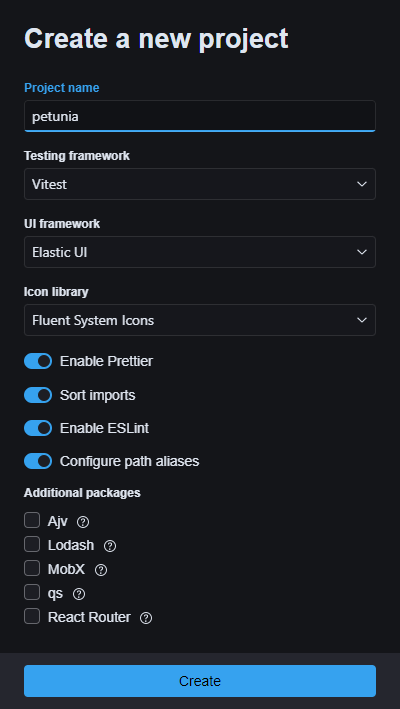

<div align="center">

# Petunia

**An opinionated project generator for TypeScript, C# and F#.**

Pick a template, toggle the options you want, and download a ready-to-run project as a ZIP file, right in your browser.

[](https://github.com/ycanardeau/petunia/actions/workflows/node.js.yml)
[](https://github.com/ycanardeau/petunia/actions/workflows/static.yml)
[](LICENSE)

### [Try it live →](https://ycanardeau.github.io/petunia/)



</div>

## Why Petunia?

- **Nothing to install.** Everything runs in the browser, and the project is generated on the client.
- **Opinionated defaults.** Formatting, linting, editor settings and `.gitignore` come preconfigured, so you can start writing code right away.
- **Only what you ask for.** Each option adds just the files, dependencies and config it needs.

## Templates

### TypeScript

| Template         | Highlights                                                                                                                                                             |
| ---------------- | ---------------------------------------------------------------------------------------------------------------------------------------------------------------------- |
| **React** (Vite) | React or Vue, app or library output · Elastic UI, Bootstrap or Mantine · MobX stores · React Router · Route Sphere · Fluent System Icons · HTTPS and proxy rules · SWC |
| **Node.js**      | Console app · MikroORM · Dockerfile                                                                                                                                    |

Every TypeScript template can also set up **Prettier** (with import sorting), **ESLint** (with optional `eslint-plugin-boundaries`), **Vitest** or **Jest**, path aliases, and handy libraries such as Lodash, qs and Ajv. You can choose npm or pnpm as the package manager.

### C#

| Template               | Highlights                                                                                                                                                                                                                    |
| ---------------------- | ----------------------------------------------------------------------------------------------------------------------------------------------------------------------------------------------------------------------------- |
| **ASP.NET Core**       | .NET Aspire AppHost and ServiceDefaults · central package management · CSharpier · optional [Aigamo.MatchGenerator](https://github.com/ycanardeau/MatchGenerator) and [Aigamo.Results](https://github.com/ycanardeau/Results) |
| **Clean Architecture** | Layered solution · Entity Framework Core with PostgreSQL or MySQL                                                                                                                                                             |

### F#

| Template  | Highlights                                                                                 |
| --------- | ------------------------------------------------------------------------------------------ |
| **Fable** | Compile to TypeScript for Node or the browser · React, Feliz, Feliz.UseElmish, Fable.React |

## Getting started

To run Petunia locally:

```bash
pnpm i
pnpm dev
```

Other scripts:

| Command      | Description                         |
| ------------ | ----------------------------------- |
| `pnpm build` | Type-check and build for production |
| `pnpm test`  | Run the test suite with Vitest      |
| `pnpm lint`  | Lint with ESLint                    |

## License

[Elastic License 2.0](LICENSE)
